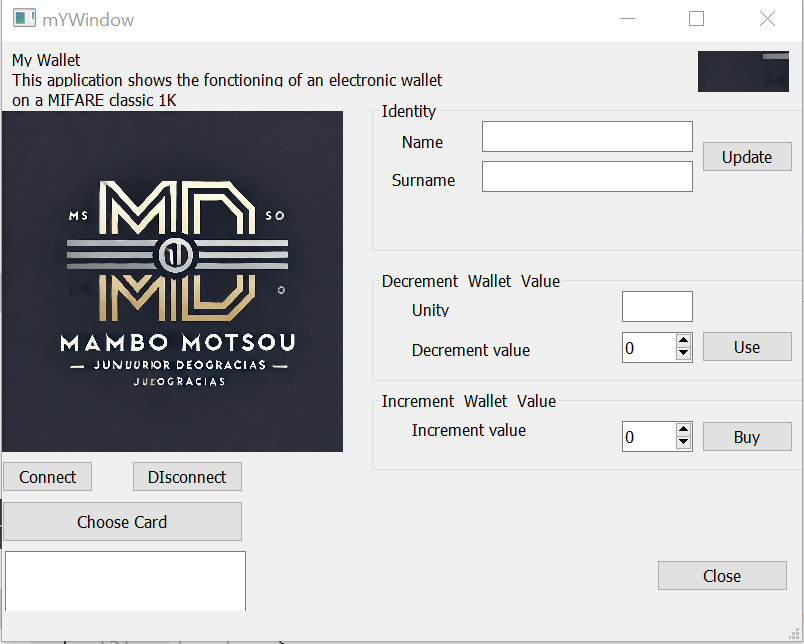

# MIFARE Classic wallet

A Qt desktop application that turns a MIFARE Classic 1K card into an electronic wallet, through an ODALID RFID reader. It writes the holder's name to the card, keeps a balance of units on it, and takes or adds units with a backup copy of the balance. A lab project from a wireless communication course (2024).

| Button | What it does |
|---|---|
| Connect, Disconnect | Opens or closes the reader (USB) and shows its version |
| Choose Card | Detects an ISO 14443-A card and reads the name, the surname and the balance |
| Update | Writes the name and the surname to the card |
| Use | Takes units from the balance |
| Buy | Adds units to the balance |
| Close | Quits |

The reader's LEDs and buzzer signal each transaction.

## The card

The application uses two sectors of the card. Its keys stay in the reader's secure element, at indexes 2 and 3.

| Sector | Block | Content |
|---|---|---|
| 2, identity | 8 | Application name, "Identité" |
| | 9 | First name (the window's Surname field) |
| | 10 | Last name (the window's Name field) |
| | 11 | Sector trailer: key A, access bits, key B |
| 3, wallet | 12 | Application name, "Porte-monnaie" |
| | 13 | Balance backup |
| | 14 | Balance, a MIFARE value block |
| | 15 | Sector trailer |

| Operation | Key |
|---|---|
| Read the name | Key A, index 2 |
| Write the name | Key B, index 2 |
| Read the balance, take units | Key A, index 3 |
| Add units | Key B, index 3 |

Use and Buy write the new balance to the backup block 13 first, then copy it to block 14, so a transaction cut short leaves one good copy.

## Building

1. Install Qt 5.15 with Qt Creator; the project was built with MinGW 64-bit on Windows.
2. Get the ODALID Education library, `ODALID_Education`, from the ODALID kit, and put it in `projectTDCOMSANSFIL/LIB/` next to its headers. It is not in this repository.
3. Open `projectTDCOMSANSFIL/projectTDCOMSANSFIL.pro` in Qt Creator, build and run, with the reader on USB.

| File | Content |
|---|---|
| [main.cpp](projectTDCOMSANSFIL/main.cpp) | Starts the application |
| [mywindow.cpp](projectTDCOMSANSFIL/mywindow.cpp), [mywindow.h](projectTDCOMSANSFIL/mywindow.h) | The window's buttons and the card operations |
| [mywindow.ui](projectTDCOMSANSFIL/mywindow.ui) | The window's layout |
| [LIB/](projectTDCOMSANSFIL/LIB/) | The ODALID library's headers |

## Report

[Rapport Tp-MAMBO_MOTSOU_junior_DEOGRACIAS.pdf](projectTDCOMSANSFIL/Rapport%20Tp-MAMBO_MOTSOU_junior_DEOGRACIAS.pdf) (in French) describes the card's layout, each button's code and the difficulties met.

## Credits

The headers in `LIB/` are ODALID's (copyright 2009–2021 ODALID, [odalid.com](https://odalid.com)), from the ODALID Education kit.
